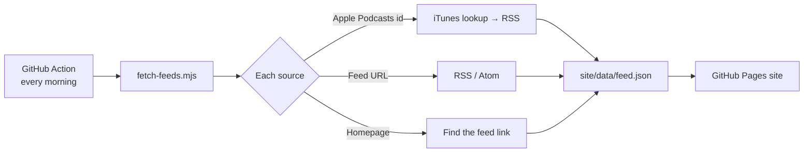

# Be a human in the loop

**A living research guide to AI × product design.** Fourteen active sources (newsletters, podcasts, research, platforms and individual designers), organized into five lenses and rebuilt every morning from their own feeds.

Built for VCS Project 2: *a living research guide that organizes active sources on a topic in digital product design.*

## What's on the site

- **Ask the guide.** Type a question and get pointed to the sources that cover it, with their newest posts.
- **The pulse.** The newest post, posts tracked over the last three weeks, and which themes the sources converge on.
- **Source map.** All 14 sources grouped by the question they answer. Pick a theme (Agents & MCP, Trust & judgment, Design-to-code…) to see which sources overlap.
- **Latest.** The newest posts from every source, filterable by lens.
- **Reading rhythm.** What to read daily, weekly and monthly.

## How it stays alive



1. `.github/workflows/update.yml` runs every day at 11:17 UTC (and on every push).
2. `scripts/fetch-feeds.mjs` reads `site/data/sources.json`, finds each source's RSS or Atom feed, keeps the newest AI-related posts, and writes `site/data/feed.json`.
3. If a source is down, its posts from the previous run are kept, so the site never goes blank.
4. The action commits the new feed and redeploys the site to GitHub Pages.

LinkedIn, Instagram and YouTube creators (TJ Pitre, Rajan Dube, Ansh Mehra) have no public feed, so the site links to their profiles instead.

## The sources

| Lens | Sources |
| --- | --- |
| **Patterns:** What will AI interfaces look like? | The Shape of AI · UX for AI (Greg Nudelman) |
| **Research:** Does it work for people? | Nielsen Norman Group · Designlab · AI and Design podcast |
| **Building:** How do products get built now? | Figma Blog · Expo · Design with AI |
| **Voices:** What are designers trying? | TJ Pitre · Rajan Dube · Ansh Mehra · Design Better |
| **Pulse:** What changed this week? | TLDR Design · AI for UX (Patrick Neeman) |

## Run it yourself

```bash
npm install
npm run fetch   # pull the newest posts into site/data/feed.json
npm start       # preview the site at http://localhost:3000
```

To add a source, add an entry to `site/data/sources.json` with its `feeds` (or `home` page, or Apple Podcasts `apple` id), then run `npm run fetch`.

## Setup on GitHub (one time)

1. **Settings → Pages → Build and deployment → Source: GitHub Actions.**
2. **Actions tab → Refresh the guide → Run workflow** to publish the first time.
